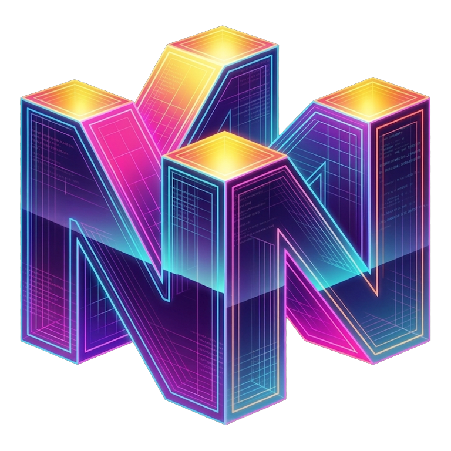
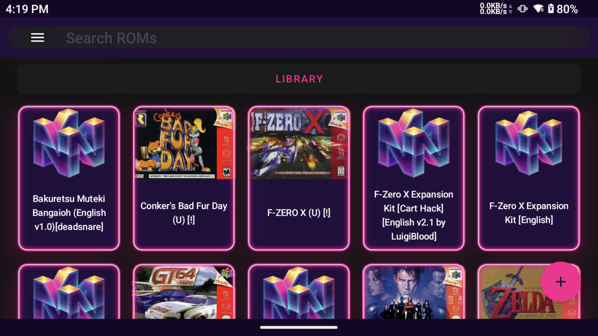
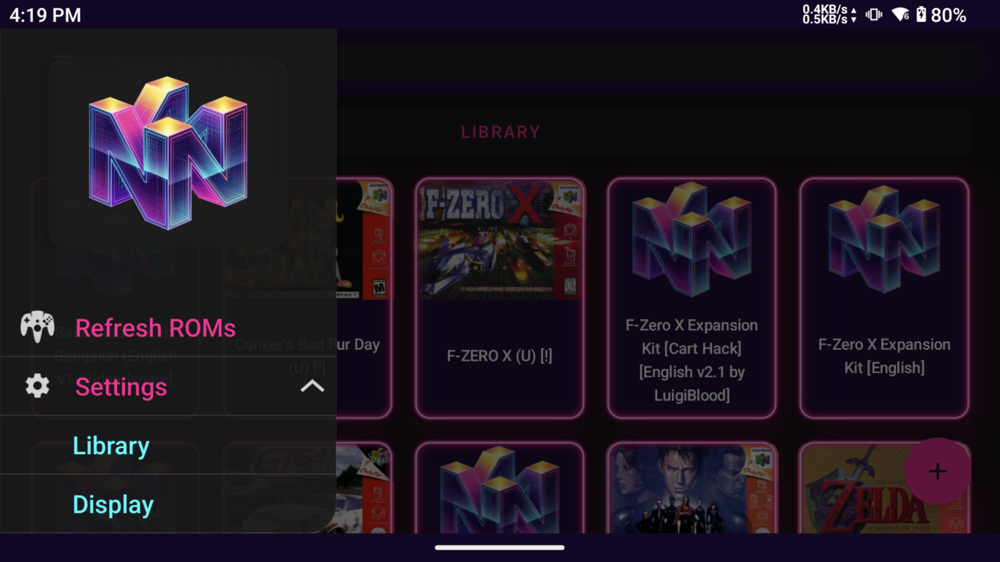
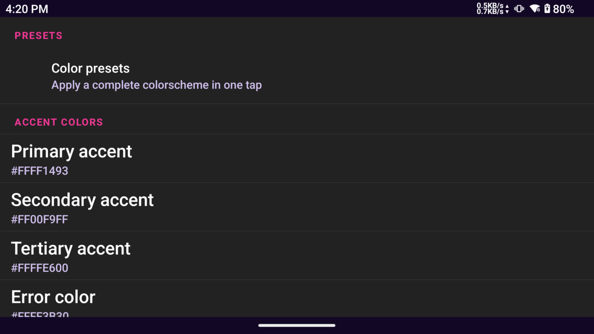
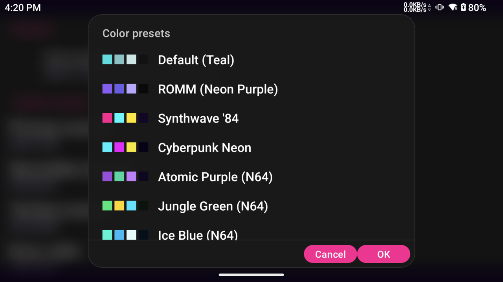

<p align="center">
  
</p>

<h1 align="center">Mupen64Plus-AE Turnip Edition</h1>

<p align="center">
  A modernized, high-performance fork of <b>Mupen64Plus-AE</b> featuring custom <b>Turnip GPU Driver integration</b>, an overhauled <b>Cyberpunk & Frosted Glass UI Engine</b>, multi-pass <b>Neon Light-Pipe Glow</b>, and full runtime theme customization.
</p>

<p align="center">
  <b>Free & Open-Source</b> &bull; No Ads &bull; No Analytics &bull; No Pro Gates &bull; Free Netplay
</p>

---

## What's New in v340

- **RetroAchievements** — achievements that read the game's memory unlock again; hardcore mode disables fast-forward, slow motion, frame advance, audio sync, loading save states, cheats and the emulator's built-in fixes for three games, and runs resumed games and netplay in casual mode; notices, challenges, progress and leaderboard attempts show during play; the in-game menu lists the game's achievements; unlocks made offline are sent after the next sign-in; and the password is deleted once a session token is saved. Going by RetroAchievements' server code, hardcore unlocks are still recorded as casual until RetroAchievements approves this app.
- **Emulator core** — upstream mupen64plus-core's bug, safety and accuracy fixes, the remaining memory-safety gaps closed, the core built without fast math, and fixes for failed save-state writes, Controller Pak saves of players 2 to 4, Game Boy saves and damaged save states. Save states are now version 1.9; 1.8 states still load.
- **Crash and hang fixes** — the crash at every game start on devices that use the 32-bit ARM or x86 libraries is fixed, and an exit through the in-game menu no longer holds its auto save back for most of a minute.
- **Netplay** — online codes are made on the device from the router's public address, without a server, and netplay rooms get several fixes. Every player needs v340: netplay no longer works with earlier builds or with the official Mupen64Plus-AE app.
- **Privacy** — a [privacy policy](PRIVACY.md) and a [licenses page](LICENSES.md), linked from the About menu; cover art over HTTPS from the maintainer's repository; no e-mail address, IP addresses or device names in the log; four fewer permissions.
- **Native libraries built from source** — libpng 1.6.59, SDL_net 2.4.0, miniupnpc 2.3.3, libnatpmp, SoundTouch 2.4.1 and FreeType 2.15.0 are now built in this repository; GLideN64's on-screen text and time-stretched audio may differ slightly.
- **Update check fixed** — version code **340**, with version name **3.0.340** plus the build commit hash. V339 carried version code 338, so it kept offering itself as an update.

[Download v340](https://github.com/pwnedbygary/mupen64plus-ae-turnip/releases/tag/v340) · [Full release notes](docs/RELEASE_V340.md) · [v338 release notes](docs/RELEASE_V338.md)

## Screenshots

| Library | Navigation drawer |
| :---: | :---: |
|  |  |

| Theme accents | Color presets |
| :---: | :---: |
|  |  |

## N64DD and Expansion Kit support

- **Native F-Zero X Expansion Kit support** — preserves cartridge-first combo boot and the DD CPU/DMA and RSP fixes from the development build. The working configuration was demonstrated on the development build. Since then, debug builds made during v340's development booted it to the title screen with the 64DD logo and the attract race on a Retroid Pocket 6, but native disk save and reopen, and writable-cart persistence, still need a device re-test, so keep backups.
- **F-Zero X EK Cart Hack works and saves** — the WritableROM fix allows the hack to save changes to its embedded Expansion Kit data, which would otherwise be treated as read-only cartridge ROM. This is separate from native N64DD support and works with N64DD disabled.
- **Per-game N64DD activation** — DD-specific behavior remains limited to games with N64DD explicitly enabled. WritableROM support for cartridge hacks remains independently controlled.

### Confirmed English Expansion Kit configuration

- F-Zero X **USA cartridge**
- English-translated **USA-region NDD**
- **Prototype USA IPL**
- **Dynamic Recompiler** and **Parallel RSP**

This configuration applies to the English translation; it is not a claim of compatibility with every cartridge, disk, or IPL combination.

**Installation and saves:** the signed release keeps the existing release package and signing identity, so it can update the earlier signed release without uninstalling. It does not replace the separate `.debug` beta or automatically transfer its private saves. Keep backups: full-restart persistence, custom-track saves, and writable-cart persistence have not been re-tested on the current binary. The device checks made for v340, on debug builds, are listed under "Device verification" in its [release notes](docs/RELEASE_V340.md#device-verification); those checks do not cover the N64DD and Expansion Kit save paths.
On a Retroid Pocket 6, a debug build of v340 ran a game with GLideN64, Rice and Glide64mk2, saved a screenshot, played sound in every audio mode tried and made a netplay code through NAT-PMP; netplay between two devices, a router's UPnP path and hi-res texture packs were not checked.

### How the EK Cart Hack saves with WritableROM

The **F-Zero X EK Cart Hack** combines the cartridge game and Expansion Kit disk data into one extended ROM. It runs as a cartridge game, rather than using an external NDD and the emulated 64DD drive. However, its save operations still target the cartridge address space containing that embedded data.

Ordinary cartridge ROM is read-only. Without special handling, those writes do not update the ROM data, so the hack can run while its editor saves fail. Our **WritableROM** fix adds an opt-in persistence path for this behavior:

1. **Enable it only for the appropriate ROM.** The per-ROM database setting `WritableROM=True` enables the feature; other cartridges retain normal read-only behavior. It does not require N64DD activation.
2. **Capture the writes.** Both direct CPU writes and PI DMA transfers into cartridge ROM space update the emulator's in-memory ROM buffer. The game can then read its changes back during the same session.
3. **Store changes separately.** Modified bytes are mirrored into a `<game-name>.cart_ram` file in the configured save directory. A companion `<game-name>.cart_ram.idx` records the address and length of each written region. **The original ROM file is not modified.**
4. **Restore only what changed.** On the next launch, the emulator loads the original ROM and overlays only the regions recorded in the index before emulation starts. Untouched ROM data stays intact. Overlapping or adjacent index entries are merged, while gaps remain separate so unwritten areas are not overwritten with zeros.

This is what lets the Cart Hack **work and save**, despite placing writable Expansion Kit data inside what would normally be read-only ROM space. It is separate from native N64DD disk saving and from emulator save states.

**Backup advice:** keep the `.cart_ram` and `.cart_ram.idx` files together, along with the game's other save files. Exit emulation normally before copying them so buffered writes are closed; this mechanism is not a guarantee against data loss from a crash or force-stop. The re-test limitations noted above still apply.

## UI and driver highlights

- **Overhauled Glassmorphic & Neon UI**:
  - Multi-pass **Neon Light-Pipe Glow** with Gaussian falloff and white-hot filament center highlights.
  - Seamless frosted-glass card presentation with dynamic translucency and specular reflections.
  - Responsive **Glass Opacity** (20%–100%) and **Card Glow** (0%–100%) slider scaling.
  - Rounded navigation drawer with outline clipping and clean dialog button spacing.
- **Dynamic Programmatic Title Layout**:
  - Automatically measures the entire library with `StaticLayout` and `FontMetricsInt` so multi-line game names (e.g. 4+ line romhacks and regional editions) render with full vertical clearance and zero clipping.
- **27 Curated Console & Cyberpunk Themes**:
  - **N64 Funtastic Classics**: *Atomic Purple, Jungle Green, Ice Blue, Fire Orange, Smoke Black*.
  - **Nintendo Legends**: *Majora's Mask, Ocarina Gold, F-Zero Mute City, Star Fox Sector X, Game Boy Classic*.
  - **Cyberpunk & Synth**: *Synthwave '84, Cyberpunk Neon, Matrix Terminal, Sakura Bloom, OLED Pure Black*.
  - **Developer Favorites**: *ROMM (Neon Purple), Tokyo Night, Dracula, Catppuccin Mocha, Nord, Monokai, One Dark, Gruvbox, Solarized, GitHub Dark, Adwaita*.
- **Integrated Skydoves ColorPicker**:
  - Compact two-column color picker dialog with live HSV color wheel, brightness/alpha sliders, direct hex input, and gamepad button confirmation (**A** / **Start** to confirm, **B** to cancel).
- **Turnip GPU Driver System**:
  - In-app driver downloader from top release sources, driver management & compatibility checks, on-disk Vulkan pipeline cache, per-game overrides, and live benchmark mode.
- **New Package Identity**:
  - Migrated package ID to `org.mupen64plusae.turnip.pwnedbygary`.

---

## Features

- **Turnip GPU driver picker** — import any standard [AdrenoToolsDrivers](https://github.com/K11MCH1/AdrenoToolsDrivers) zip, or **download one directly in-app** from well-known release sources (K11MCH1/AdrenoToolsDrivers, StevenMXZ, The412Banner/Banners-Turnip, MrPurple666/purple-turnip, whitebelyash, nihui/mesa-turnip-android-driver). The driver is extracted to internal storage and loaded via [libadrenotools](https://github.com/bylaws/libadrenotools) when the **Parallel vulkan renderer** is selected.
- **Driver management** — shows installed driver version, required API level, library name, GPU model, and per-driver benchmark scores. Incompatible drivers are rejected on import with automatic update notifications when newer releases are published.
- **On-disk Vulkan pipeline cache** — the Parallel plugin persists its `VkPipelineCache` to internal storage, eliminating first-launch shader stutter.
- **Driver benchmark mode** — toggleable timed benchmark that measures average FPS to compare Turnip against system drivers.
- **ParaLLEl-RDP** Vulkan renderer with upscaling, texture filtering, and modern RDP accuracy.
- **All classic plugins**: GLideN64, glide64mk2, GLN64, Rice, Angrylion, plus HLE/cxd4/parallel RSPs.
- **RetroAchievements** — sign in from the app, see unlocks, server problems, the session's mode, active challenges, achievement progress and leaderboard attempts on screen while you play and open the game's achievement list from the in-game menu, with unlocks and leaderboard entries made offline sent after the next sign-in and hardcore mode enforced on loading save states and slots, cheats, GameShark and game speed (normal speed only: no fast-forward, slow motion, frame advance or audio sync; resumed games and netplay run in casual mode).
- **Netplay, profiles and archives**: Local and room-based netplay, touchscreen/controller profiles, and zip ROM support (7z on Android 7.0 or newer).
- **In-app update checker** — checks for new releases directly from GitHub and notifies you when an update is available.

---

## Requirements for the Turnip Driver

- 64-bit ARM device (`arm64-v8a`) running **Android 9 or newer** (Adreno GPU)
- A driver zip in AdrenoToolsDrivers format (containing `meta.json` and driver `.so`)

The custom driver applies to the **Parallel** plugin (the Vulkan renderer). If the driver fails to load on a specific device, the app falls back to the system Vulkan driver automatically.

---

## Compatibility

- Android 6.0 and newer (`minSdk 23`), built for Android 14 (`targetSdk 34`) and device-tested on Android 13
- `arm64-v8a` is the primary target; `armeabi-v7a`, `x86` and `x86_64` are packaged as well

---

## Downloads

| Build Type | Link |
| :--- | :--- |
| **Latest Signed Release — v340** | [Download v340](https://github.com/pwnedbygary/mupen64plus-ae-turnip/releases/tag/v340) |
| **Nightly CI Builds** | [![Build Status][Build]][Actions] |

[Actions]: https://github.com/pwnedbygary/mupen64plus-ae-turnip/actions/workflows/build.yml
[Build]: https://github.com/pwnedbygary/mupen64plus-ae-turnip/actions/workflows/build.yml/badge.svg

---

## Build Instructions

Prerequisites:
- Android SDK (Platform 34, Build Tools 34.0.0, NDK 26.1.10909125, CMake 3.22.1)
- JDK 17

```bash
git clone https://github.com/pwnedbygary/mupen64plus-ae-turnip.git
cd mupen64plus-ae-turnip
./gradlew assembleDebug
```

---

## Privacy and licenses

- [Privacy policy](PRIVACY.md): what the app sends, to whom and when, what stays on your
  device, and how to delete it.
- [Licenses](LICENSES.md): the app's license, and each third-party library, data file and
  piece of art found in the app, with its license, its upstream link where known and the
  full text of its notice.

---

## License

Licensed under the **GNU General Public License v3.0** (see [`gpl-license`](gpl-license)),
following Mupen64Plus-AE. The app also contains third-party code, data and art under other
licenses, such as the vendored [libadrenotools](https://github.com/bylaws/libadrenotools)
(BSD-2-Clause), and two parts that are not open source. [LICENSES.md](LICENSES.md) lists
them.
